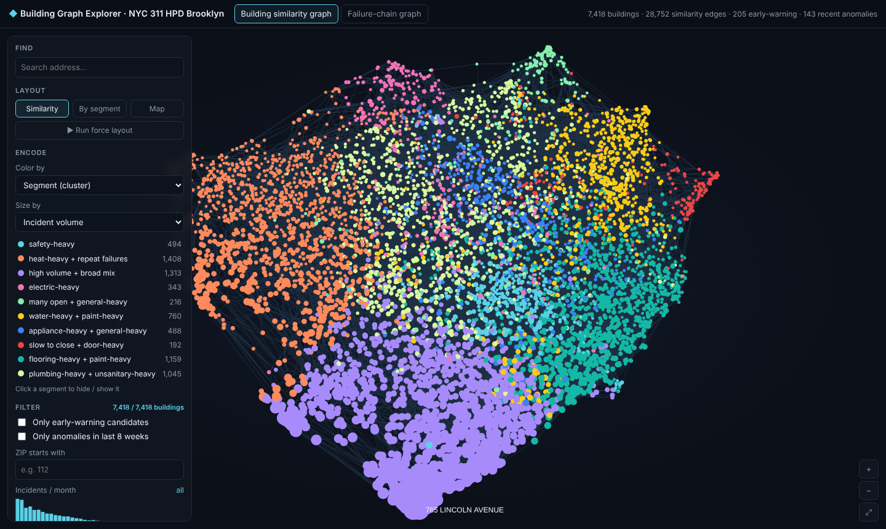
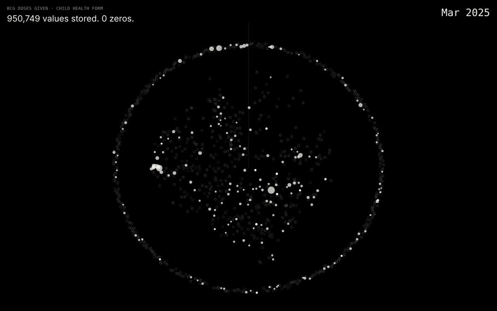

# all-is-data

After spending so much time collecting and organising data, I’m increasingly interested in what happens once it's cleaned, structured and finally behaving itself.

I want to explore how to tell stories through data visualisation. Not just make pretty charts, but find the patterns, unexpected connections and little stories hiding inside complicated datasets.

I like starting with a question, following the data, and occasionally discovering that the interesting answer belongs to a completely different question.

The challenge is to make all that complexity understandable without throwing away the interesting bits.

And if the result happens to be beautiful, even better.

## Issues

| # | Story | Data | Read |
|---|---|---|---|
| 01 | **[Which building will complain next?](https://feedgine.github.io/all-is-data/nyc311-predictive-maintenance/)** Two years of Brooklyn housing complaints, 7,418 buildings arranged by how they break, and one chain of cause and effect that turned out to be something else. | NYC 311 housing complaints (HPD, Brooklyn, Nov 2024 – Oct 2026, 478k rows) | [Story](https://feedgine.github.io/all-is-data/nyc311-predictive-maintenance/) · [Explorer](https://feedgine.github.io/all-is-data/nyc311-predictive-maintenance/docs/graph_explorer.html) · [Report](https://feedgine.github.io/all-is-data/nyc311-predictive-maintenance/docs/report.html) · [Code](nyc311-predictive-maintenance/) |
| 02 | **[Listening to what a health system doesn’t write down](https://feedgine.github.io/all-is-data/dhis2-missing-data/)** Resonant Gaps: a DHIS2 health export played back as silence. Blank cells, missing reports and missing populations become a map, a rhythm and a drone. | DHIS2 Sierra Leone demo database (HISP, University of Oslo), 2025, 1,166 facilities | [Story](https://feedgine.github.io/all-is-data/dhis2-missing-data/) · [Piece](https://feedgine.github.io/all-is-data/dhis2-missing-data/sierra-leone-demo/) · [Video](dhis2-missing-data/sierra-leone-demo/preview.mp4) · [Notes](dhis2-missing-data/) |

[](https://feedgine.github.io/all-is-data/nyc311-predictive-maintenance/)

[](https://feedgine.github.io/all-is-data/dhis2-missing-data/)

## How each issue is built

```
all-is-data/
└── <issue>/
    ├── index.html       the story: scroll to read, interactive graphics alongside
    ├── README.md        method, results, how to rebuild
    ├── fetch_data.py    downloads the raw data into data/ (data is not committed)
    ├── *.ipynb          the analysis, executed
    └── docs/            interactive outputs and the files the story page loads
```

Some issues publish only the finished work and its notes, without the build code (Issue 02).

## Reading the stories

The pages are static. Turn on **GitHub Pages** (Settings → Pages → deploy from branch `main`, folder `/ (root)`) and each story is served at `https://feedgine.github.io/all-is-data/<issue>/`.

GitHub's file view shows HTML as source code. For a local preview, run `python -m http.server` in the repo folder and open `http://localhost:8000/<issue>/`.

## Licence

- **Code** (Python, JavaScript, notebook code): [MIT](LICENSE)
- **Stories, text and images:** [CC BY 4.0](LICENSE-CONTENT.md). Share and adapt freely, with credit: *Julia Malinina, all-is-data*.
- **Data** stays under its publisher's terms (see each issue's `data/README.md`).
