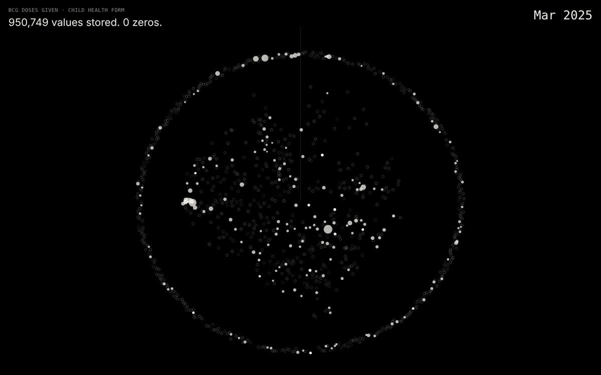

# Resonant Gaps · listening to what a health system doesn't write down

**Issue 02 of all-is-data** · Feedgine (Julia Malinina)

**[Read the issue](https://feedgine.github.io/all-is-data/dhis2-missing-data/)** · **[Enter the piece: Sierra Leone (demo)](https://feedgine.github.io/all-is-data/dhis2-missing-data/sierra-leone-demo/)** · [Preview video](sierra-leone-demo/preview.mp4)

[](https://feedgine.github.io/all-is-data/dhis2-missing-data/)

## Statement

Data is usually read for what it contains. **Resonant Gaps** reads it for what it leaves out. The project takes exports from heavily measured systems and treats their nulls, dropouts and omissions as the material of the work.

This issue is the health-records movement. Its source is **DHIS2**, the open-source platform many ministries of health use to collect monthly reports from every clinic in the country. Each report is a promise that something was counted. When a clinic loses power, when a form is sent half empty, when a population figure was never entered, the promise breaks quietly. The national charts still draw a line.

Here the breaks are made audible. A recorded value is a tone. A blank cell is a short burst of noise, because nobody can say whether it means zero or nothing. A missing report is silence, and silence takes up space in the rhythm.

## Four kinds of silence

| | Movement | What you see and hear | Sierra Leone (demo), 2025 |
|---|---|---|---|
| 1 | **Zero or missing** | Every facility on a map. Values ping, blank cells hiss, missing reports are silent. Facilities with no coordinates circle the map they are missing from. | 950,749 values stored, **0 zeros**. 565 of 1,166 facilities have no location. |
| 2 | **Reporting rhythm** | 13 district rings, one spoke per monthly report. Each district is a note in a shared pulse; a missing report is a skipped beat. | 83.4% of Child Health reports arrived; December drops to 773 of 1,158. |
| 3 | **Ghost denominators** | Rings filled by vaccine coverage. Facilities without a population figure drift as dashed ghosts under a detuned drone. | **134 facilities** (11.5%) have no under-1 population; their BCG doses still inflate district coverage. |
| 4 | **Watched and unwatched** | A missingness matrix: 9 data elements × 1,166 facilities × 12 months. Each element is a voice. | ANC 1st visit 81.6% filled; maternal death 2.4%; ART forms 0.8% and under-5 mortality forms 0.1% of expected. |

## Countries

<!-- COUNTRIES:START -->
| Country | Source | Period | Headline |
|---|---|---|---|
| [Sierra Leone (demo)](https://feedgine.github.io/all-is-data/dhis2-missing-data/sierra-leone-demo/) | DHIS2 demo database (HISP, University of Oslo) | Jan–Dec 2025 | 950,749 values, 0 zeros; 134 facilities with no denominator |
<!-- COUNTRIES:END -->

## About the data

The first piece uses the **Sierra Leone demo database** that the DHIS2 team at the University of Oslo (HISP) runs publicly for training and testing. It mirrors the real structure of Sierra Leone's health system (13 districts, 152 chiefdoms, 1,166 facilities), but much of its data is synthetic or regenerated each year. Read the patterns as **structural**, not epidemiological.

Only aggregate counts per facility and month are used, taken through the public DHIS2 Web API. There is no personal or patient-level data. See [`data/README.md`](data/README.md) for sources and terms.

## What's in this folder

```
dhis2-missing-data/
├── index.html              the issue: statement, video, four movements
├── README.md               this file
├── data/README.md          sources and terms
└── <country>/
    ├── index.html          the interactive piece (sound starts on click)
    ├── preview.mp4         28-second recording with sound
    └── img/                poster and stills
```

This issue publishes the work and its findings. The extraction and build tooling is not part of the repository.

## Background reading

- Zero vs missing values in DHIS2 reporting: [BMC Public Health, 2023](https://link.springer.com/article/10.1186/s12889-023-15979-z)
- DHIS2 data quality guidance: [docs.dhis2.org](https://docs.dhis2.org/en/implement/data-quality/implementation-of-funtionality-and-procedures.html)

## Licence

Text, images and video: [CC BY 4.0](../LICENSE-CONTENT.md), credit *Julia Malinina, all-is-data*. Page code: [MIT](../LICENSE). Data stays under its publisher's terms.
