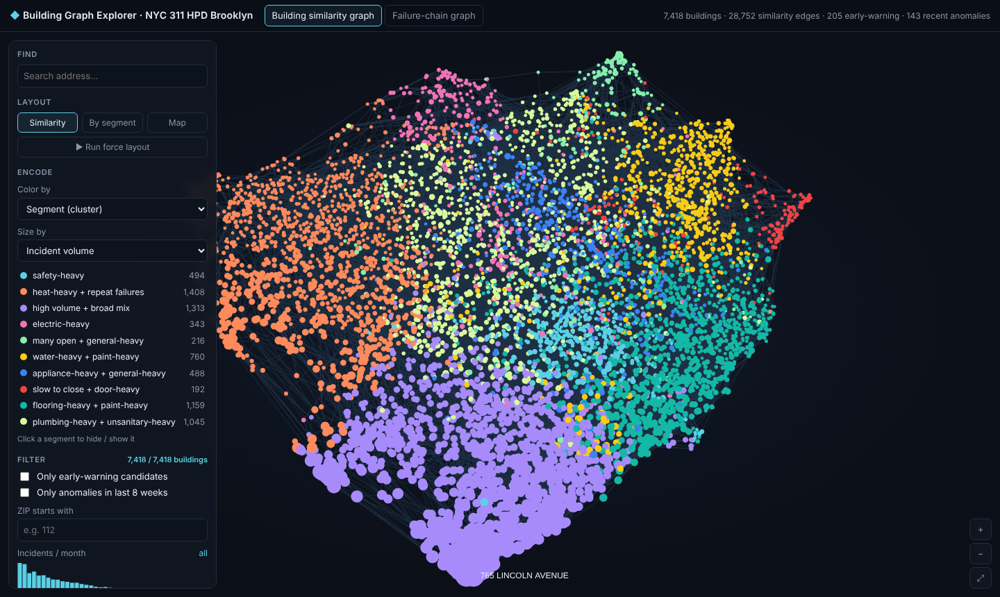
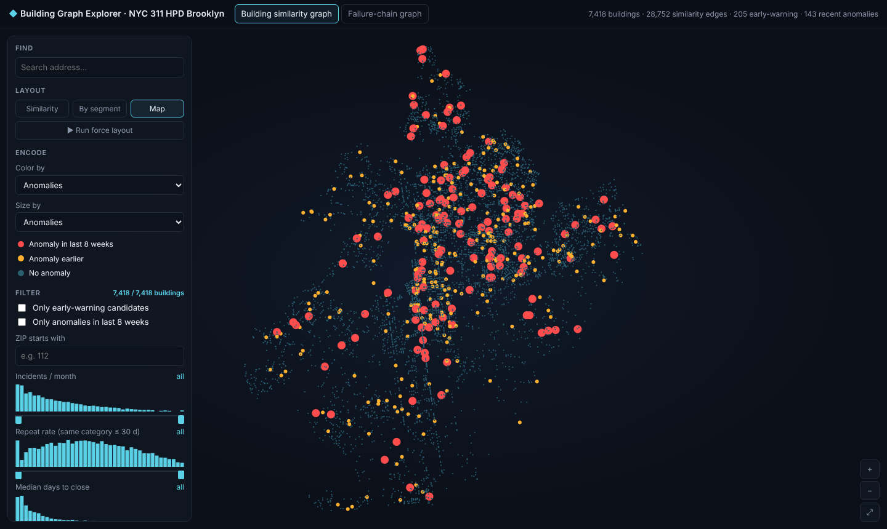
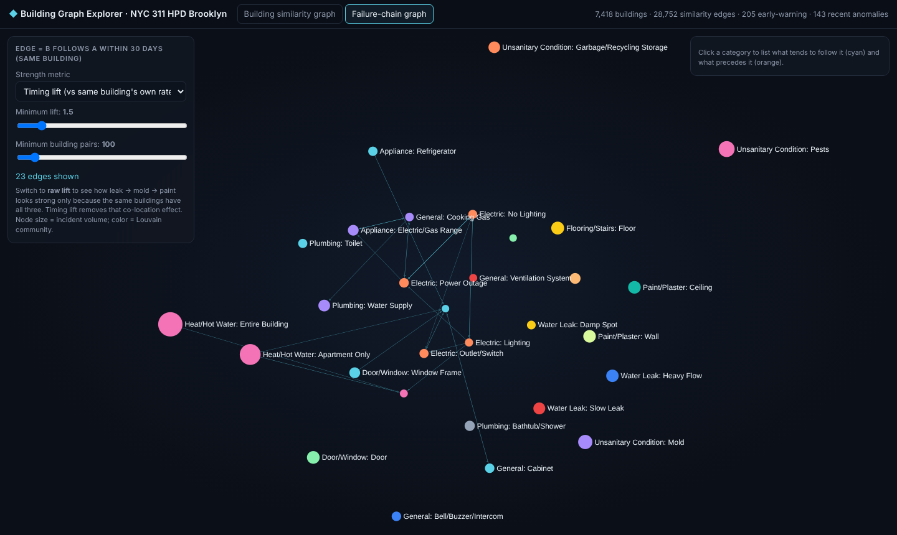

# Issue 01 · Which building will complain next?

**Live:** [feedgine.github.io/all-is-data/nyc311-predictive-maintenance/](https://feedgine.github.io/all-is-data/nyc311-predictive-maintenance/)

**[Read the story →](https://feedgine.github.io/all-is-data/nyc311-predictive-maintenance/)** · [Explorer](https://feedgine.github.io/all-is-data/nyc311-predictive-maintenance/docs/graph_explorer.html) · [Full report](https://feedgine.github.io/all-is-data/nyc311-predictive-maintenance/docs/report.html)

Can ordinary maintenance tickets predict the next problem in a building?
This issue uses **NYC 311 housing complaints** (HPD, Brooklyn, Nov 2024 – Oct 2026) as a public stand-in
for a property manager's ticket log: one building (BBL) ≈ one property, complaint type ≈ ticket category.



## What's inside

| Technique | Question it answers | Method |
|---|---|---|
| **Anomaly spikes** | Which building is unusual *this week*? | Seasonality-aware Poisson baseline (building share × borough total) + Isolation Forest; flagged when both agree |
| **Building segments** | What kinds of buildings are there? | Behaviour profile (volume, category mix, repeat rate, time to close, seasonality) → PCA → KMeans; UMAP for display |
| **Failure-chain graph** | Does problem B tend to *follow* problem A? | Directed co-occurrence within 30 days, lift against a building-level null model, Louvain communities |
| **30-day risk model** | Which building will file category X next month? | Gradient-boosted trees on recency/frequency features, strict time split (train May 2025–Mar 2026, test May–Sep 2026) |
| **Graph explorer** | Explore all of the above interactively | Graphistry-style WebGL explorer (sigma.js + ForceAtlas2), histogram filters, inspector, map view |

## Key results

- **478,559** complaints (476,816 with a building ID) → **348,648** incidents after merging same-day duplicates, across **29k** buildings.
- **Risk model:** ROC-AUC **0.82** on the later hold-out, against 0.74 for a "recent problems repeat" rule.
  The top 1,000 flags per month are right **58%** of the time (rule: 46%).
- **Early warning:** for categories not reported in the last 90 days, the top-500 list is about **10× better than random**.
  A hotspot list can't produce this at all.
- **Anomalies:** 630 building-weeks flagged by both detectors. The typical pattern is a quiet building suddenly filing
  10–25 issues across many categories (an inspection sweep or a management change).
- **Chains:** once you control for "busy buildings have everything", real sequences are electrical
  (outage → no lighting) and gas → range. The intuitive leak → mold → paint "chain" comes from co-location, not timing.
  The explorer's *raw vs timing lift* toggle shows the difference.

| | |
|---|---|
|  |  |
| Anomalies on the map (red = last 8 weeks) | Failure chains after removing co-location |

## Open the outputs

- [`index.html`](index.html): the story. Scroll to read; the graph alongside changes with each step. Ends with the full explorer.
- [`docs/graph_explorer.html`](docs/graph_explorer.html): the explorer on its own, one offline file (3.4 MB).
- [`docs/report.html`](docs/report.html): the full report with charts, tables and watch lists.

View them through GitHub Pages or a local server (see the root README).

## Exploring the graph

The explorer is a Graphistry-style graph: dark background, WebGL rendering, a live force layout and histogram filters. It works offline and sends no data anywhere.

1. **Building similarity graph:** 7,418 buildings, each linked to its 5 most similar buildings (28,752 edges).
   * Layouts: Similarity, By segment, Map, or ▶ Run force layout to watch it settle.
   * Colour and size by: segment, dominant category, 30-day risk, early-warning candidates, anomalies, repeat rate, or days to close.
2. **Filters:** drag the two handles under each histogram (volume, repeat rate, days to close, risk) to narrow the range. Tick "only early-warning" (205 buildings) or "only recent anomalies" (143), filter by ZIP, or click a segment in the legend to hide it.
3. **Inspector:** click a building to see its stats, category mix, early-warning flag and most similar buildings. Double-click to zoom in. The search box finds an address.
4. **Failure-chain graph:** lift and minimum-pairs sliders, and a toggle between timing lift and raw lift. Raw lift turns the leak → mold → paint "chain" into a hairball; timing lift shows how little of it is about sequence.

**Which buildings are in the graph:** buildings with at least 10 incidents over the two years (one placeholder building ID excluded). That is 7,418 of 29,306 buildings, a quarter of them, but 82% of all incidents. Below 10 incidents a category mix is mostly noise.

## Run it yourself

```bash
pip install -r requirements.txt
python fetch_data.py                                    # ~2–5 min, ~100 MB into data/
jupyter nbconvert --to notebook --execute --inplace \
  --ExecutePreprocessor.timeout=1500 NYC311_predictive_maintenance.ipynb   # ~4 min → docs/report.html
python export_graph.py                                  # → build/graph_data.json
cd explorer && npm install && npm run build && cd ..   # bundles the explorer and docs/story.js
python explorer/assemble.py build/graph_data.json docs/graph_explorer.html   # also writes docs/gx_data.js
```

Optional: `graphistry_upload.py` pushes the same graph to a [Graphistry](https://www.graphistry.com/) GPU server.
It needs an account and network access, and it uploads addresses and risk scores to that server.

## Files

| File | Purpose |
|---|---|
| `fetch_data.py` | Paged download from the NYC Open Data API (SoQL filter: HPD, Brooklyn, since 2024-11-01) |
| `NYC311_predictive_maintenance.ipynb` | The analysis, executed (source mirrored in `analysis.py`) |
| `report_builder.py` | Assembles `docs/report.html` |
| `export_graph.py` | Builds the graph data for the explorer |
| `index.html` | The story page; loads `docs/gx_data.js` and `docs/story.js` |
| `explorer/` | Front-end source: `main.js` + `template.html` (explorer), `story.js` (story page), `assemble.py` |
| `docs/` | Generated outputs: report, explorer, story data and script, key numbers, watch list, screenshots |

## Caveats

311 is tenant-reported and regulator-facing, not an operator's ticket log. Duplicates and inspection sweeps inflate spikes.
The hold-out covers one summer only, so heat predictions need a winter check. Watch lists are model outputs
on public data, not statements about any building's condition.

Data: [NYC Open Data, dataset erm2-nwe9](https://data.cityofnewyork.us/Social-Services/311-Service-Requests-from-2020-to-Present/erm2-nwe9/about_data),
under the [NYC Open Data Terms of Use](https://opendata.cityofnewyork.us/overview/#termsofuse).
